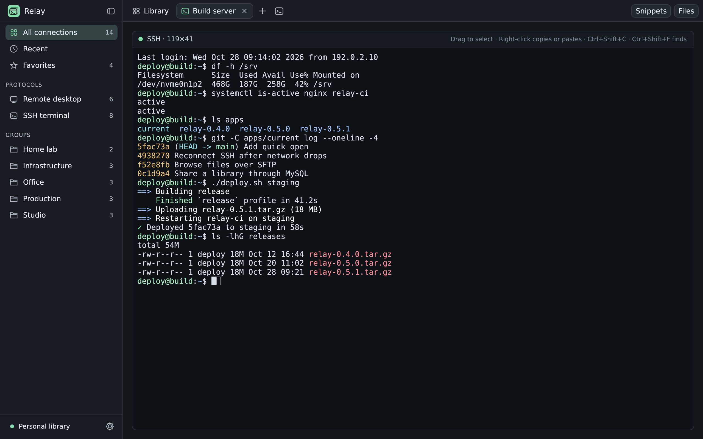
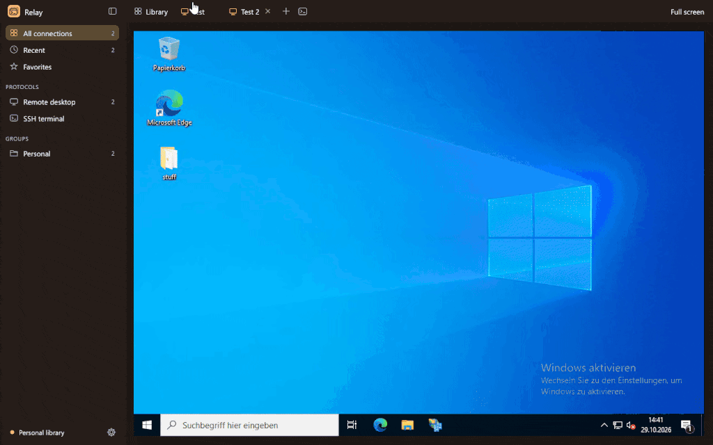

# Relay

**All your remote machines in one calm, fast window.**

Relay keeps your RDP, VNC and SSH connections in a searchable library and opens them in tabs: remote desktops, terminals and file browsers, side by side if you like. It's a small native app for Windows, macOS and Linux, written in Rust.

## What you get

- **Remote desktops, terminals and files in one place.** RDP, VNC, SSH and SFTP open as tabs. Put two side by side, or move one into its own window.
- **Remote desktops that fit.** A remote desktop takes the size of its tab and your monitor's scaling, and follows along when you resize or switch monitors, so text stays sharp and the usual size.
- **Find anything in a keystroke.** Search by name, host, user, group or notes with `Ctrl+K`, or jump straight to a recent connection with `Ctrl+T`.
- **Works with what you already have.** SSH runs through your system's OpenSSH, so your config, keys, agent and jump hosts just work.
- **Your passwords stay yours.** Relay never stores remote passwords.
- **Quiet on the network.** Relay connects only to the servers and libraries you set up: no update checks, no telemetry, no accounts.
- **Bring your connections along.** Import from `~/.ssh/config`, `.rdp` files, CSV or JSON.
- **Share with your team.** Keep one library on SQL Server, MySQL or MariaDB, or a shared SQLite file.
- **Make it yours.** Six color themes, plus terminal color schemes and fonts.

## Install

Download the archive for your platform from the [latest release](https://github.com/nurlennart/relay/releases/latest).

| Platform | Download | Notes |
| --- | --- | --- |
| Windows 10/11 (x64, Arm64) | `relay-<version>-windows-*.zip` | Unzip and run `relay.exe`. SSH uses the **OpenSSH Client** optional feature. |
| macOS 11+ (Apple silicon and Intel) | `relay-<version>-macos-universal.zip` | Unzip and move **Relay.app** to Applications. The app is not notarized: the first time, right-click it and choose **Open**. |
| Linux (x86_64, aarch64) | `relay-<version>-linux-*.tar.gz` | Extract and run `./install.sh` to install into `~/.local`. |

Nothing else is needed: on Windows, remote desktops use the same control as Remote Desktop Connection, and on macOS and Linux Relay brings its own RDP client. VNC, including a Mac's Screen Sharing, works everywhere with Relay's own client.

## Get started

1. Click **New connection** (`Ctrl+N`) and enter a name and a host. Already have connections elsewhere? Import them from **Settings → Library**.
2. Double-click the connection, or select it and press `Enter`. It opens in a tab.
3. In a hurry? Type a host such as `admin@server`, `rdp://desktop` or `vnc://pi` in the search box and press `Enter` to connect without saving it.

On macOS, use `Cmd` wherever this page says `Ctrl`.

## A closer look

An SSH terminal with colors, search, clickable links and saved command snippets:

A file browser beside its terminal, with drag-and-drop uploads and a transfer queue:

Remote desktops right in a tab, resizing as you go:

## Handy shortcuts

| Keys | Does |
| --- | --- |
| `Ctrl+K` | Search the library |
| `Ctrl+T` | Quick open a recent connection or a host |
| `Enter` / `Shift+Enter` | Connect / browse an SSH connection's files |
| `Ctrl+N` | New connection |
| `Ctrl+Tab`, `Ctrl+1`–`9` | Switch tabs |
| `Ctrl+\` | Split with the neighbouring tab, or unsplit |
| `Ctrl+W` | Close the tab |
| `Ctrl+Shift+T` | Open a local shell |
| `Ctrl+Shift+P` | Run a saved snippet in an SSH tab |
| `F1` | Show every shortcut |

## Learn more

The [user guide](docs/guide.md) covers everything in detail:

- [Connection library](docs/guide.md#connection-library): groups, favorites, choosing several connections, split view and detached windows
- [Import and export](docs/guide.md#import-and-export): SSH config, `.rdp`, CSV and JSON
- [Shared team libraries](docs/guide.md#shared-team-libraries): setting up MSSQL, MySQL or SQLite
- [Remote desktops](docs/guide.md#sessions), [VNC](docs/guide.md#vnc), [SSH](docs/guide.md#ssh) and the [file browser](docs/guide.md#sftp-file-browser)
- [Where Relay keeps your data](docs/guide.md#where-relay-keeps-data)

Found a bug? The version and commit are at the top of **Settings**; click them to copy both into your report. To build Relay yourself, see [CONTRIBUTING.md](CONTRIBUTING.md).

## License

Relay is released under the [MIT License](LICENSE).
